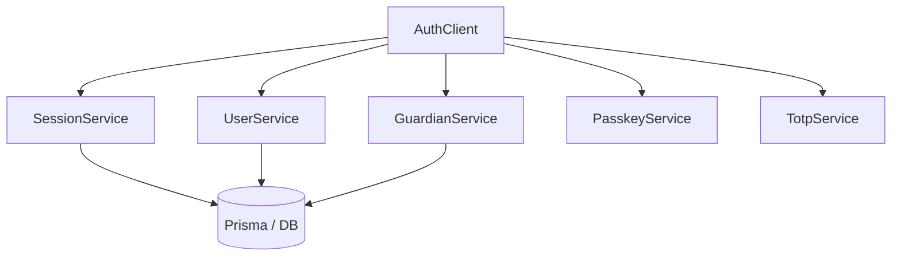

# System Internals

`open-auth` is designed as a series of decoupled domain packages orchestrated by a central `AuthClient`.

## Orchestration Pattern

The `AuthClient` (exported as `auth`) doesn't implement much logic itself. Instead, it acts as a **Facade** over several specialized services.

### Example: `signInWithEmailPassword`
When you call `signInWithEmailPassword`, the following sequence occurs:

1. **Rate Limiting**: `guardian.globalPOSTRateLimit` is checked.
2. **Risk Assessment**: `guardian.risk.assessSignInRisk` evaluates the IP and UserAgent.
3. **Turnstile**: If risk is high, a Cloudflare Turnstile token is mandated.
4. **Lockout Check**: `guardian.lockout.isAccountLocked` checks for too many failed attempts.
5. **Credential Verification**:
    - `account.getAccountByEmail` retrieves the account.
    - `password.verifyPasswordHash` compares the provided password using **Argon2id**.
6. **Session Creation**:
    - `session.generateSessionToken` creates a random 20-byte token (encoded in Base32).
    - `session.createSession` hashes the token via **SHA-256** and stores the hash in the DB.
7. **Cookie Management**: `session.setSessionTokenCookie` sets the secure cookie.

## Security Decisions

### Token Hashing
We never store raw session tokens or password reset tokens. We store their SHA-256 hashes. This ensures that even with read-access to your database, an attacker cannot hijack active sessions without the original tokens stored on clients.

### Token Format
Tokens are generated using `crypto.getRandomValues(20)` and encoded using `Base32` (via `@oslojs/encoding`). This makes them roughly 32 characters long, URL-safe, and easily readable if necessary.

### Password Hashing
We use **Argon2id** for all password hashing, which is the current industry standard for resistance against GPU-based cracking and side-channel attacks.
